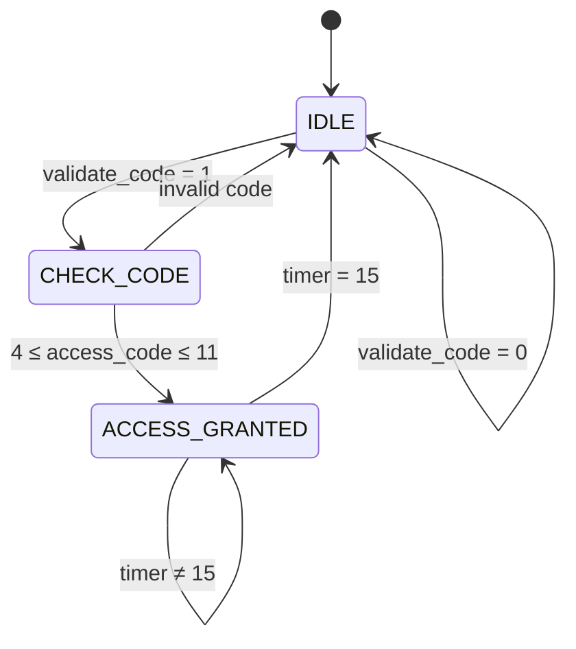

# Metro Turnstile: FSM-Based Metro Turnstile Controller

A Verilog finite state machine (FSM) that controls a metro turnstile gate. The controller moves from `IDLE` to `CHECK_CODE` to validate a 4-bit access code, and opens the gate in the `ACCESS_GRANTED` state for a fixed time before returning to `IDLE`. The design was verified in simulation and implemented on an FPGA using **Xilinx Vivado** (simulation, synthesis and implementation).

## Features

- 3-state FSM: `IDLE` → `CHECK_CODE` → `ACCESS_GRANTED`
- 4-bit metro access code validated against a valid range (4 to 11)
- Gate stays open for 16 clock cycles, controlled by a 4-bit timer
- Asynchronous active-low reset
- `state_out` debug port to observe the current state (e.g. on LEDs)
- Self-checking testbench covering all 16 codes, boundary values, timing and reset

## State machine



| State | Encoding | Description | `open_access_door` |
|-------|----------|-------------|--------------------|
| `IDLE` | `2'b00` | Waits for `validate_code` | 0 |
| `CHECK_CODE` | `2'b01` | Checks whether `access_code` is in the valid range | 0 |
| `ACCESS_GRANTED` | `2'b10` | Gate open while the timer counts to 15 | 1 |

The output depends only on the current state, so this is a **Moore** machine. The design uses a registered state with a separate combinational next-state block, plus a timer that runs only in `ACCESS_GRANTED`.

### Behavior summary

1. After reset the FSM is in `IDLE` with the gate closed.
2. When `validate_code` goes high, the FSM moves to `CHECK_CODE`.
3. On the next clock edge, if `4 ≤ access_code ≤ 11` the FSM moves to `ACCESS_GRANTED`. Otherwise it returns to `IDLE`.
4. In `ACCESS_GRANTED` the gate is open for 16 clock cycles, then the FSM returns to `IDLE`.

`access_code` must be stable during the clock cycle in which the FSM is in `CHECK_CODE`.

## Ports

| Port | Dir | Width | Description |
|------|-----|-------|-------------|
| `clk` | in | 1 | System clock |
| `rst_n` | in | 1 | Asynchronous active-low reset |
| `validate_code` | in | 1 | Request to validate the access code |
| `access_code` | in | 4 | 4-bit metro access code |
| `open_access_door` | out | 1 | High while the gate is open |
| `state_out` | out | 2 | Current state (debug) |

## Repository structure

```
metro-turnstile-fsm/
├── src/
│   └── fsm1.v                  # FSM controller (design)
├── sim/
│   ├── tb_fsm1.v               # Basic testbench with $monitor output
│   └── tb_fsm1_selfcheck.v     # Self-checking testbench (PASS/FAIL)
└── README.md
```

## Simulation

1. Create a Vivado project and add `src/fsm1.v` as a design source.
2. Add `sim/tb_fsm1_selfcheck.v` (and optionally `sim/tb_fsm1.v`) as simulation sources.
3. Set the testbench as the simulation top and run **Run Simulation → Run Behavioral Simulation**.

### What the self-checking testbench verifies

| Test | Check |
|------|-------|
| Reset | FSM in `IDLE`, gate closed |
| No `validate_code` | FSM stays in `IDLE` |
| Access codes 0–15 | Codes 4 to 11 are granted, all others denied (including boundaries 3, 4, 11, 12) |
| Gate timing | `open_access_door` is high for exactly 16 clock cycles |
| Reset during access | Asynchronous reset closes the gate immediately, and the timer restarts for the next entry |

The console prints one line per code and ends with `PASS: all tests passed`, or lists each failure.

The inputs are driven on the falling clock edge while the FSM samples on the rising edge, which avoids race conditions between the testbench and the design.

## FPGA implementation

1. Run **Synthesis → Implementation → Generate Bitstream** in Vivado.
2. Add a constraints file (`.xdc`) mapping the ports to your board's pins (for example switches for `access_code` and `validate_code`, LEDs for `open_access_door` and `state_out`).
3. Program the device from **Hardware Manager**.

**Note on clock speed:** at a 100 MHz board clock the gate stays open for only 16 cycles, which is 160 ns, far too short to see on an LED. For a visible result, drive `clk` from a clock divider (for example about 1 Hz, giving roughly 16 seconds of open time) or a debounced push button.

## Known limitations and future improvements

- The valid code range (4 to 11) is fixed in the RTL. A stored list of codes or a parameterized range would be more flexible.
- If `validate_code` stays high with an invalid code, the FSM repeatedly cycles `IDLE` → `CHECK_CODE` → `IDLE`.
- `validate_code` and `access_code` are not synchronized or debounced for use with physical switches and buttons.
- The gate-open time is fixed at 16 cycles and could be made a parameter.
- Possible additions: entry counter, alarm or error state after repeated invalid codes, and a clock divider module for on-board demos.

## Tools

- Verilog HDL
- Xilinx Vivado (simulation, synthesis, implementation)

## License

This project is licensed under the MIT License. See the `LICENSE` file for details.

## Author

Your Name — [GitHub profile](https://github.com/your-username)
